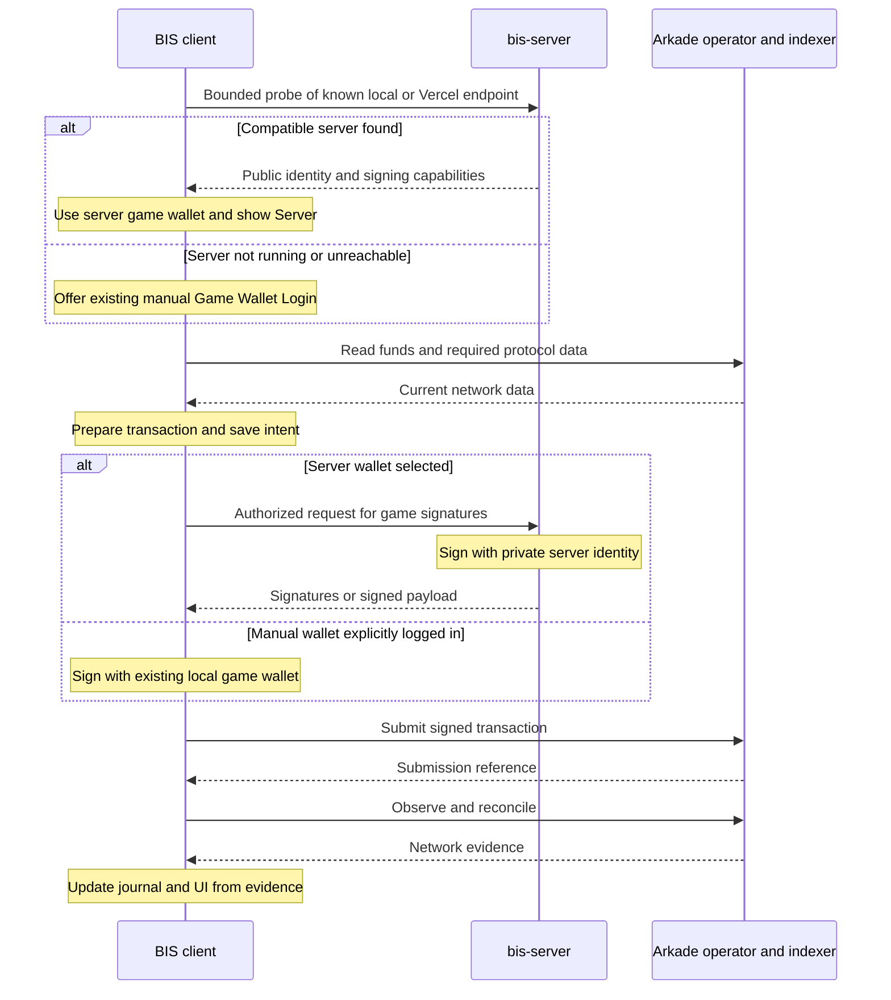

# Design

## Current release decisions and finite order

The user's 2026-10-29 decision supersedes older Signet-only consumer gates and export ordering in this document. Required source tuples are Mutinynet/Direct and Signet/Server. Hosted Mutinynet and stronger unqualified Treasure enforcement remain future work, not prerequisites for these tuples.

| Step | Owner | Work and verifiable exit |
| --- | --- | --- |
| 1 | BIS, with game inventory | Record the fixed feature matrix below, baseline evidence, exact candidate source and per-network live-test budget. Every row has one owner, expected result and evidence requirement. No funding until actual amounts/fees fit existing caps. |
| 2 | BIS | Select Direct for Mutinynet before probing; select Server for Signet; preserve explicit safe Signet Direct fallback. Add the upper-left mode label, retain network/version and separate health. Pass focused routing, stale-reply, UI and no-server-request checks. |
| 3 | BIS | Verify every applicable Direct Mutinynet matrix row with BIS server access blocked. Repair regressions and retain real network receipts for financial behavior. No hosted Mutinynet opt-in is needed. |
| 4 | BIS | First prove one actual Server Signet boarding/signing path, then cover every applicable server workflow and authorization role. Require exact transaction/asset/fee receipts, not generic message proof. |
| 5 | BIS then game | Freeze source, pass required BIS tests/types/build/release checks, pack only integration and verify inventory/hash/provenance. Authorize local import of this candidate before publication. Game installs exactly that hash and verifies public API compatibility. |
| 6 | Game, financial slot serialized | Verify both network/mode tuples on the imported candidate: ordinary gameplay, account, continuation, inventory/rewards, and real Treasure funding/Claim/Reject/expiry/recovery. Exercise actual slow/offline/hidden-tab behavior and network/source changes. |
| 7 | Coordinator, then owners | Finish Sandbox Treasure Hunt pages 22–25 as one direct-SDK real lifecycle on both networks; vet source/controls/reload/unknowns, exact receipts and Conditional Vault, then pass combined final-candidate checks. |
| 8 | BIS then game | Publish the exact accepted BIS/Admin/Marketplace/Sandbox and matching game through existing workflows after both tuples and Sandbox pass locally. Verify exact deployment commits and complete versions. |
| 9 | Coordinator and owners | Finalize all four public Sandbox pages, public app mode/version/feature checks, README links/cache-busters and immutable assets. Review evidence, strict-validate and close only completed required release tasks. Keep future hosted Mutinynet and stronger unqualified modes deferred. |

Steps 3 and 4 can proceed independently after step 2, but one owner controls BIS source and only one financial slot exists. Game-only routing/consent work can proceed before step 5; package-dependent integration and live game acceptance use the exact imported candidate. There is no dependency from local import to prior public publication.

### Fixed feature matrix

For each applicable consumer, require both Mutinynet/Direct and Signet/Server coverage of: Player account create/restore/logout and network-scoped saved profiles; Game Wallet identity/login or server resolution; addresses, copy, balances and history; receive/send and existing Bitcoin/Arkade transfer/boarding/offboarding paths; Admin mint/burn and asset delivery; Marketplace mint/checkout, ownership and asset change; game inventory/equipment/trophy rewards; paid continuation at its unchanged actual price; Treasure consent, real 1,000-sat funding, empty-Player Claim, Reject, original 90-second expiry/refund, new-Start/session-end cancellation, recovery import/export and uncertain/lost-ack preservation. Include the new header, guest gameplay, server absence and network changes. A prior unfinished unrelated feature is not silently added, but an enabled baseline action cannot be disabled to pass.

Financial evidence records actual network, signer source, immutable artifact/hash, original inputs, outputs, amount, fee and terminal receipt. Admin-only actions use private owner authentication where required; this does not turn them into public permissions. A generic low-value payment does not prove paid continuation at the real game price. Reuse evidence only when its affected source/behavior still matches; required current-artifact funded game cases remain mandatory.

### Source and header semantics

Network routing is part of the shared public BIS composition, not a global force-manual flag. Mutinynet Direct must make zero BIS signer probes, plans, grants or signing requests, even when a hosted endpoint is configured. It continues to use Arkade and Bitcoin providers. Signet Server keeps Player signing local and server keys private. Reachable authorization/configuration errors remain explicit. Manual fallback requires a clean, explicit new-work boundary.

The top header places the exact text `Server` or `Direct` at the upper-left, with current network and BIS version retained. Once a network is selected, the label identifies the selected workflow, including while a server connection is pending or failed. Connection health is shown separately and cannot fabricate readiness. Before network selection, no source is asserted. Changes invalidate stale replies and preserve the original source of all pending operations. The source label is independent of Treasure's Browser validation/co-signer guarantee labels.

### Bounded execution

Use the existing registered test wallets and unchanged 5,000-sat operation / 10,000-sat per-network rolling-day limits. Preserve the old refund and B2 reservations on their actual identities; they do not prohibit unrelated eligible identities. Compute the complete remaining test budget first, including actual continuation price and carrier sats. If it cannot fit, record the exact next eligible window rather than repeatedly attempting admission. Never increase caps or change prices to make tests fit.

For a defect, capture a safe precise failing boundary, reproduce without spending when possible, apply one coherent fix and rerun affected checks. Do not repeat unchanged full suites, generic probes or the same inconclusive network request. Unknown financial outcomes stop competing spends on their scope; they do not stop disjoint implementation. The failed diagnostic setup is not a network outcome. Local candidate import is allowed after package checks; public release stays gated on both complete workflows.

## Current execution ownership

The 2026-10-29 takeover section of the BIS program ledger supersedes historical owner/thread assignments and obsolete package-version observations in this document. It does not supersede contract guarantees or safety requirements. Use the actual accepted candidate version, archive hash and source evidence rather than a historical 0.0.27/0.0.29/0.0.30 observation.

The server/BIS owner follows the execution order in proposal.md. One owner writes BIS runtime/release files, one writes game runtime/release files, and the coordinator writes the shared program ledger. Only the assigned financial-slot owner may operate protected acceptance wallets. The other owner can prepare wallet-free code, fixtures, synchronization and browser observations.

Local candidate export requires frozen source, passing package checks and exact provenance. Tasks 5.1/5.5 supply live acceptance and 5.2/5.4 supply final publication; neither public release is a prerequisite for local integration import.

Preflight the exact test command, browser cache and private temporary-path requirements with a small affected check. Reuse unchanged-source evidence, run focused checks during fixes, and run required integrated checks after the candidate is frozen. Do not start competing suites or replace real hidden-tab or network evidence with injected state.

## Context

See proposal.md for motivation and scope. `createBisGameWallet` currently constructs a local controller and encrypted browser storage; `app-wallet-session.ts` and `adapter-wallet.ts` create SDK identities from account phrases. `AccountCard.tsx` owns the shared network/version banner, and `BIS/scripts/dev-config.ts` owns shared Vite middleware.

Installed SDK 0.4.79 exposes public-key methods, transaction signing, message signing and stateful signer sessions. The Node faucet is evidence of server signing, not proof of remote-identity or Vercel compatibility. Stealth & Steel currently vendors BIS 0.0.23 and has its own Vite configuration and push-triggered Pages workflow; BIS is currently 0.0.24. Choose the actual release version from repository state when applying, not from these observations.

## Goals / Non-Goals

Goals: server-first Signet Game Wallet signing locally and on Vercel; existing manual login when no server is running/findable; all three published consumers working at this proposal's finish line. Mutinynet hosted signing remains unavailable until proposal 2. Player signatures and transaction preparation/submission/reconciliation stay client-owned.

Non-goals: moving full mint/checkout/contract workflows into the server, a server operation journal, background completion while browsers are closed, game saves, anti-cheat, new rewards or fee-payer changes. These belong to the separate milestone 2 or later changes.

## Decisions

### Package and identity boundary

Use `BIS/packages/bis-server`, package `@bis/bis-server`, with a Node service layer, Vite middleware adapter and Vercel adapter. Load `BIS_GAME_WALLET_MNEMONIC` from server-only `.env.local` locally, with process environment precedence, and Vercel private environment configuration when hosted. Keep blank tracked templates and never use `VITE_` for signing secrets.

Represent server wallets with public identity/source references, not dummy recovery phrases. Adapt only the game role/session identity boundary so games keep the public BIS contract and Player Wallet remains local. Preserve the browser's current operation preflight, reservations, preparation, submission, journal and reconciliation. Proposal 1 deploys and accepts Signet only; expose Mutinynet as unavailable to hosted signing.

The versioned API exposes public identity/capabilities and authorized signing. Support public keys, transaction input indexes and foreign partial signatures, message signing, and the actual SDK signer-session interface exercised by existing workflows. Verify asynchronous HTTP compatibility with that interface before claiming parity. Session IDs, public nonces and partial signatures bind to one transcript; never expose secret nonce state or reuse it. Include HD/descriptor support if existing enabled workflows exercise it. An unsupported existing path is a milestone blocker, not permission to disable it silently.

### Resolution and manual fallback

Development uses a known same-origin `/api/bis/` path for Signet Server, optionally forwarded to an explicitly configured local BIS server. Pages Server builds use the explicit Vercel URL. Do not scan hosts or treat arbitrary HTML as a server. Mutinynet selects Direct immediately and skips BIS server resolution entirely.

In Signet Server mode, probe on initialization, player login/logout, relevant configuration changes and Retry. Coalesce probes and ignore superseded replies. Compatible connection removes the need for Game Wallet Login. The upper-left mode label and separate health status follow the semantics above. Direct never probes.

Absent route, stopped server, connection refusal, network failure or bounded reachability timeout means no findable server for new work. Offer the existing manual create/restore/login flow even if the attempted endpoint was configured. This applies to local and published clients. Tell the developer the reason and retain Retry; do not auto-select a saved browser identity.

A reachable server reporting wrong network/game/API version, invalid mnemonic setup or authorization rejection reports a configuration/access error with Retry. It is not classified as missing. A slow wallet/provider operation is not a failed connection probe.

Manual login captures a source selection. A later successful background probe can advertise server availability but must not replace an active manually selected wallet under pending work; adopt the server at a clean explicit selection/lifecycle boundary. Similarly, losing a selected server offers manual login for independent new work, but never re-signs/replays or reconciles an existing server operation through a local wallet. Preserve source-specific records across reload, player changes and network switches. Player logout clears player-scoped requests/UI, not the server's identity.

### Local development and debugging

Mount handlers in the root Vite listener beside current BIS package routes; no additional required API daemon. Allow explicit disabling of the signer middleware so server-absent behavior is reproducible. Keep a single owner for signer sessions across HMR or invalidate sessions explicitly.

Provide documented breakpoints/logging for client preparation, server signing and operator submission using sanitized metadata only. The adjacent game's Vite config proxies the known local API to the shared BIS Vite instance or mounts the exported server middleware. Local pages must not silently call production Vercel or share its signer/session store. Use separate test identities and state namespaces for local, Preview and production demos.

### Vercel Signet signing is part of proposal 1

Grill Question 1 now authorizes the three public settlement/contract/asset flags in the existing Production service on Signet. Apply them during execution without rotating keys, reducing protection, widening network scope or increasing the existing operation/daily caps. Verify the actual frozen deployment and policy before any funded acceptance. The previous absence of explicit flag approval is resolved; actual network receipts and all remaining requirements stay mandatory.

Deploy the same signing service to Vercel Node Functions while static UIs remain on Pages. Never rely on one warm process, local files or an in-memory lock for hosted correctness. A serverless-compatible shared store must support atomic signing-request claims, transcript/replay records, reservations and signing-session continuity where the SDK requires it. Proposed default is a Marketplace Redis integration, subject to available account/free-tier limits.

Keep secret session state server-only and encrypted at rest if persisted. A restart or lost session must either resume the exact safe session or fail explicitly and preserve unresolved signing reservations. Test cold starts, separate instances, concurrent callers and lost responses. Lease expiry alone never proves that signed inputs are unspent. The minimal signing ledger is required here; the full wallet-operation journal is deferred.

Use server-verifiable short-lived signing grants scoped to game, network, identity, operation ID and exact signing intent. For the public Signet test demo, session issuance can be public but its authority is bounded by server-defined transaction/asset policies, per-request/rate/global spending caps and allowed signing purposes. Derive allowed destinations from validated request context, not from a client claim of trust. Persist cap consumption atomically. Privileged Admin actions require owner authentication supplied privately, never a key compiled into Pages. CORS/Origin allowlisting is an integration boundary, not authorization. Mutinynet signing authorization and acceptance belong to proposal 2.

Keep public hosted signing restricted to configured disposable test-network identities. Local owner development sessions may permit the existing developer workflows; hosted policy must cover every enabled current action, or that missing parity blocks completion. This is not server validation of gameplay completion.

Official deployment references reviewed during planning: [Functions limits](https://vercel.com/docs/functions/limitations), [Hobby plan](https://vercel.com/docs/plans/hobby), [Marketplace storage](https://vercel.com/docs/marketplace-storage). Hobby currently permits personal/non-commercial use and bounded function execution. Recheck quotas, eligibility and datastore terms during deployment; free-tier feasibility is a target, not a promise. Obtain project/store access and private environment values at apply time, not in chat.

### Operation boundary

The existing client/server/operator Mermaid diagram is retained below. Hosted signing uses the same ownership boundary as local signing.

Stateful SDK protocols can require more exchanges. Signature success is not mint/delivery confirmation. Existing Bitcoin providers still participate in boarding where required.

## Risks / Trade-offs

- Remote identity may need multiple protocol methods and state. Verify the actual installed SDK and supported network end to end before promising existing-workflow parity.
- A hosted signer authorizes spending. Enforce bounded server policy and private owner authorization in this milestone; moving the seed alone does not enforce gameplay.
- One game identity is shared by consumers. Atomic hosted coordination and preserved browser reservations must prevent conflicting signing across Admin, Marketplace and the game.
- A backend outage makes manual login available but cannot change the wallet owning an unresolved operation. Keep source-specific recovery visible and prevent duplicate retries.
- Vercel availability and Arkade availability differ. `Server` indicates a compatible signer connection, not spendable funds or successful transactions.
- Public Pages apps use the same GitHub Pages origin across repository paths. Validate game/backend/network scope in addition to Origin.
- Changes span two repositories. Preserve unrelated edits, use verified package transfer, and check both deployment workflows.

## Migration Plan

### Confirmed wallet-pool deployment inputs

The operator subsequently approved six Production Secrets: slots 01/02/03 for
each of Signet and Mutinynet, named `BIS_GAME_WALLET_<NETWORK>_<SLOT>_MNEMONIC`.
Select the first valid candidate meeting the operation's freshly checked
requirements within its network. An identity-only probe can use an unfunded
candidate. Confirmed Bitcoin is not Arkade-spendable balance. Pin the selected
profile for signing and recovery; fallback never replaces the signer of pending
work or crosses networks.

Preview signing configuration is separate from Production. Preview uses
`BIS_PREVIEW_`-prefixed counterparts for owner authorization, caps, Redis
credentials, and all six test-wallet slots. The server maps those values to its
runtime names only when `VERCEL_ENV=preview`; missing Preview values are
removed rather than inherited from Production. Production ignores the prefixed
names. Preview wallet slots must be distinct, unfunded test identities; never
copy Production or DPAPI vault mnemonics into Preview.

Deployment inputs approved on 2026-10-21 are Vercel project `bis-server` in
Asher's projects, free tiers only with no paid upgrades, and caps of 10,000 test
sats/day per network and 5,000 sats/operation, following the operator's later
approval to accommodate upcoming pricing. Signet wallet 01 has separate
permission for at most 10,000 faucet test sats. These inputs do not authorize
unrestricted signing or imply that funding or acceptance has occurred.

Initial implementation/deployment status is recorded in
`BIS/documentation/bis-server-deployment.md`. The initial runtime deliberately
reports public signing disabled. Owner-only grants and conservative input-value
limits are scaffolding, not the required public workflow policy or current-action
parity. Do not treat that deployment as completion of tasks 4.2-4.4 or 5.1-5.5.

Implement only this milestone first. Test the signer locally, then through Vercel cold starts and concurrent requests. Add local-vs-Pages backend configuration and document manual fallback. Keep source records recoverable if backend URLs change.

Deploy bis-server with private test credentials and bounded public policy. Export the frozen, package-verified immutable local candidate plus SHA-256 manifest before publication, integrate and accept both consumer workflows and Sandbox, then publish through the existing versioning and Pages contract. Import that exact package into Stealth & Steel, update dependency/lockfile and matching release identities, add only required backend configuration/proxy changes, run the real contract checker and game publishing tests/build, and push the matching game release through its existing Pages workflow.

Complete the release only after published Admin, Marketplace and Stealth & Steel demonstrate all applicable Signet Server and Mutinynet Direct workflows, the upper-left mode header, and controlled safe Signet fallback. Hosted Mutinynet remains unavailable. Keep deterministic UI checks separate from approved live network evidence.

Rollback disables new server requests while preserving signing/operation recovery records; manual login is available for separate new work. Never export the server mnemonic to a browser as rollback. Proposal 2 qualifies Signet and Mutinynet together and hardens remaining multi-network behavior. Full-operation server execution remains separately deferred in host-bis-server-game-wallet.
